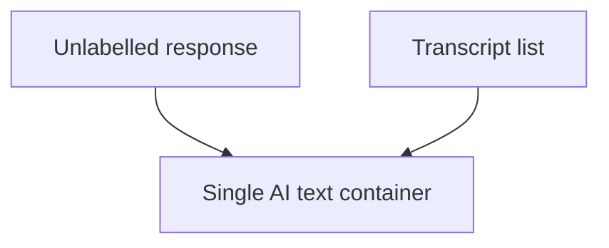
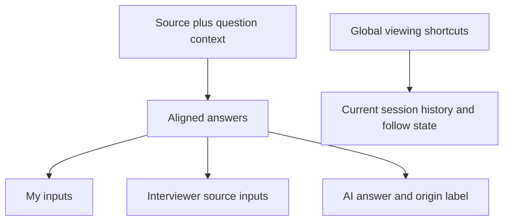
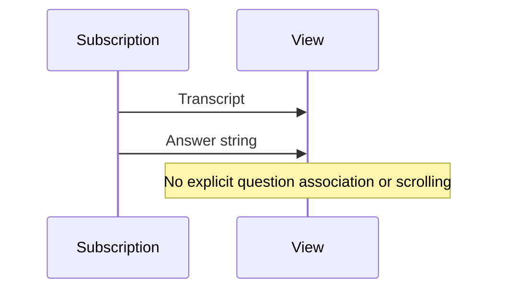
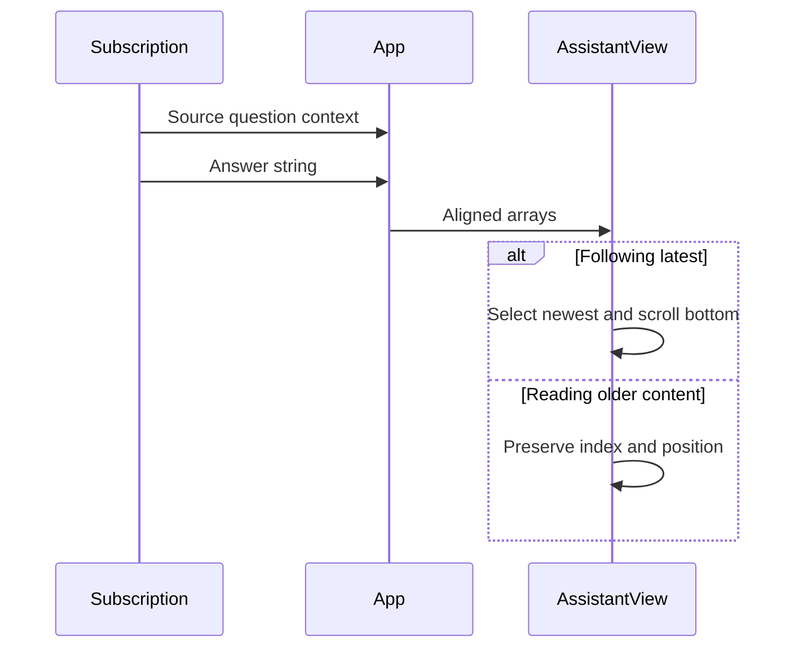
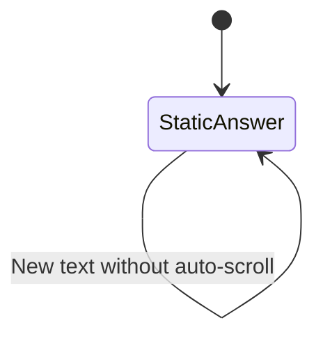
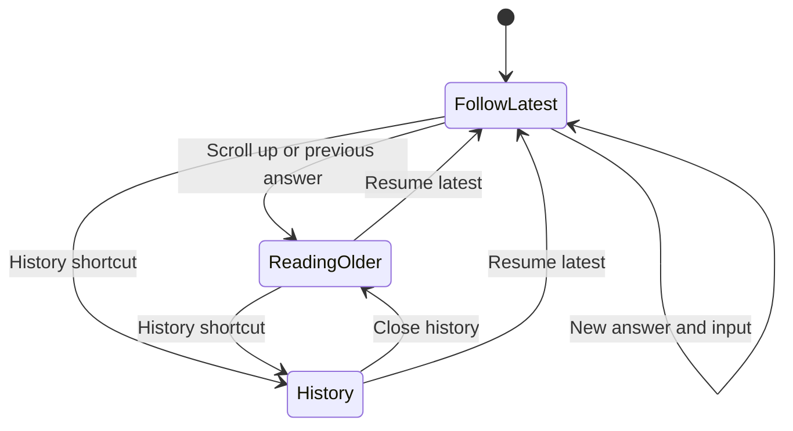
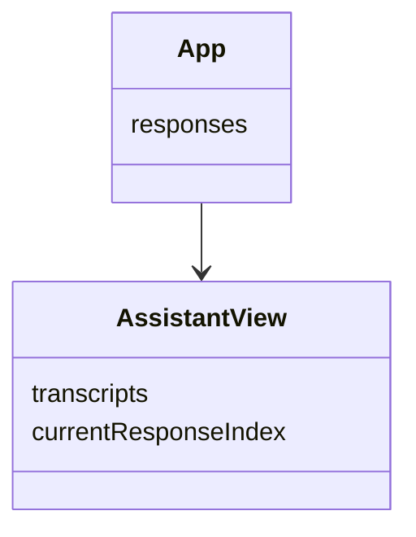
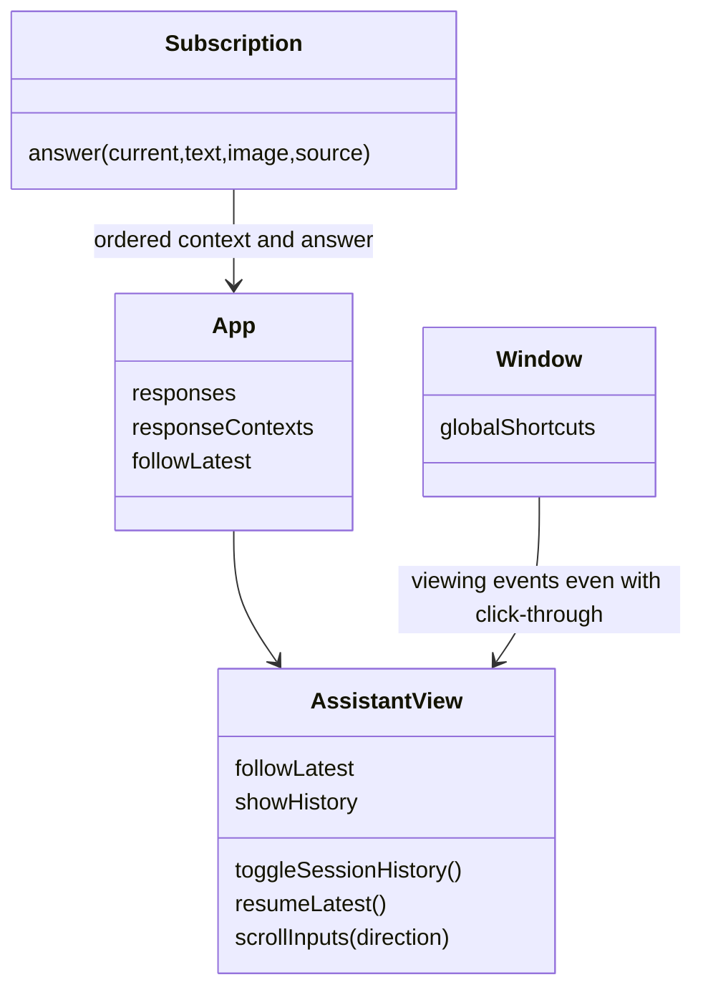

# 0.8.7：来源分区、会话历史与默认跟随

Fixed point: `04eda92cdd0f183302c996919ced2bcf1925c419`（已验收的0.8.6自动录音与签名保持不动）。

用户合同：我、面试官的原始转写、AI生成回答要区分，回答要对应输入；鼠标穿透仍能用快捷键翻页、看历史；默认随新消息往下滚动，主动回看时不抢位置。未授权新增录音快捷键或push-to-talk，不新增这些。

Interface：Subscription Adapter在原new-response之前发送subscription-answer-context={source,question}；主视图按事件顺序将上下文与每条回答对齐。mic/text/file是我的来源，system是对方来源，不是声纹识人；同一输入里混合多人不能自动分辨。面试官栏明确提示system audio未开启；不会伪造不存在的对方转写。AI历史对原文使用Lit文本插值，不把原始输入作为Markdown/HTML解析。

导航：Cmd/Ctrl+Shift+Up/Down翻AI回答或当前历史页；Cmd/Ctrl+[ / ]切换回答；Cmd/Ctrl+Shift+H切换当前会话历史；Cmd/Ctrl+Shift+L回最新并恢复跟随；Cmd/Ctrl+Alt+Up/Down翻两栏输入记录。沿用Cmd/Ctrl+M鼠标穿透。现有持久化旧会话仍在侧栏历史记录，本快捷键历史是当前会话，不能混称已实现跨会话快捷键。快捷键可在通用设置修改。

followLatest默认true；新回答自动选最新且滚到底，原始输入栏也跟随。向上滚/前一回答/打开历史会暂停；回最新显式恢复。不能在用户回看时把位置顶走。

## 当前/目标架构

## 当前/目标时序

## 当前/目标状态

## 当前/目标类关系

验证：源事件配对单测、默认跟随与暂停单测、实际Lit页面E2E验证三分区、历史显示、滚动位置及IPC导航。UI注入测试数据仅用于界面合同，不冒充真人/AI真实回答；安装版另验真实文字或语音回答与全局快捷键注册/鼠标穿透的事件效果。录音链路不得退回未签名或默认raw版本。
