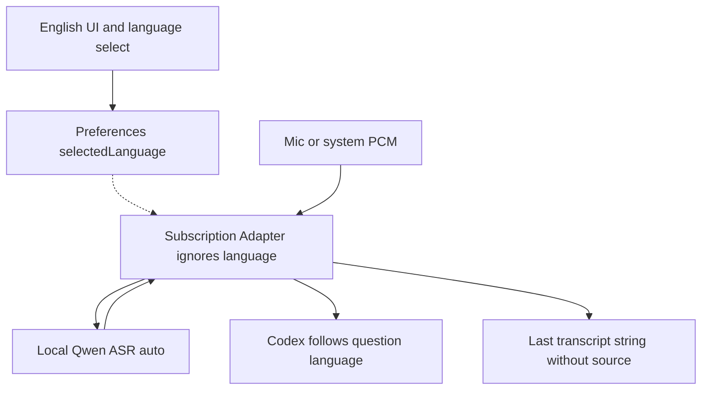
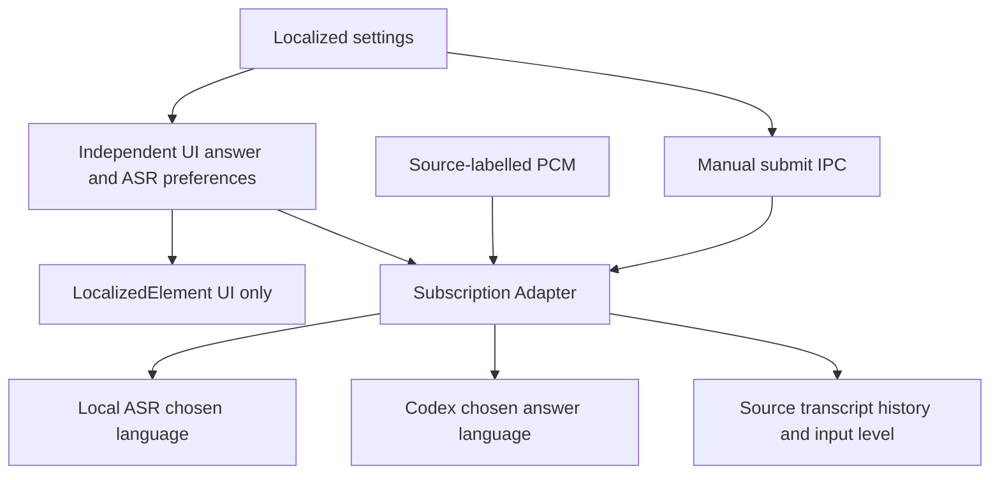
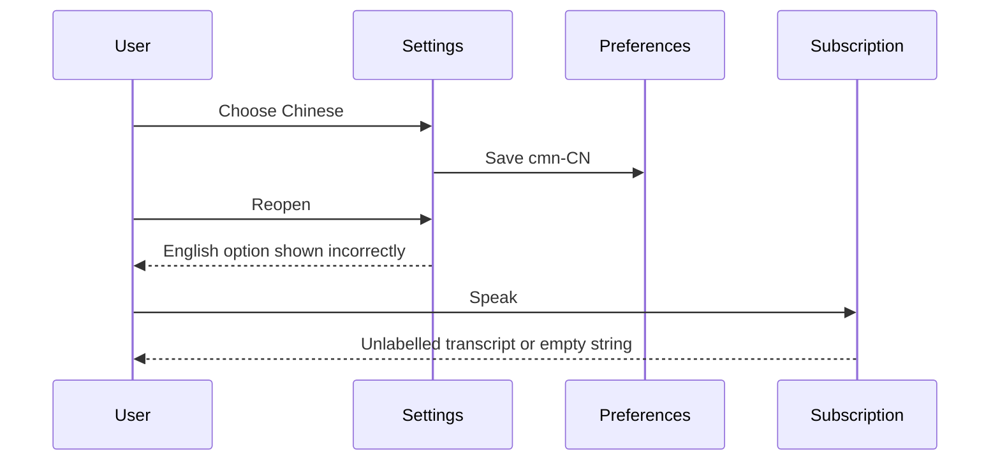
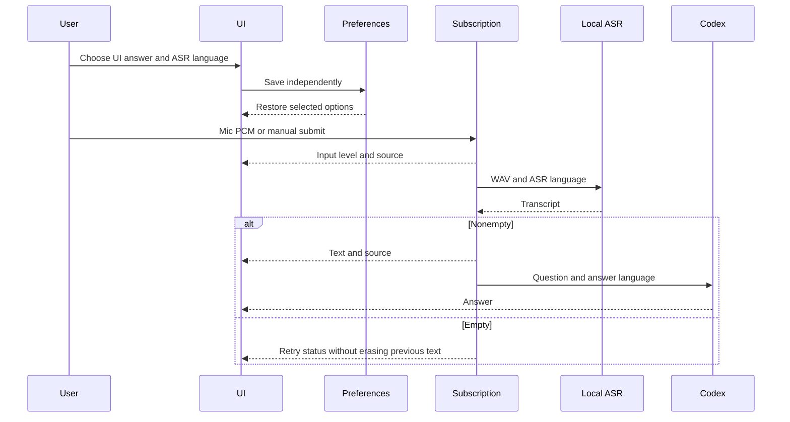
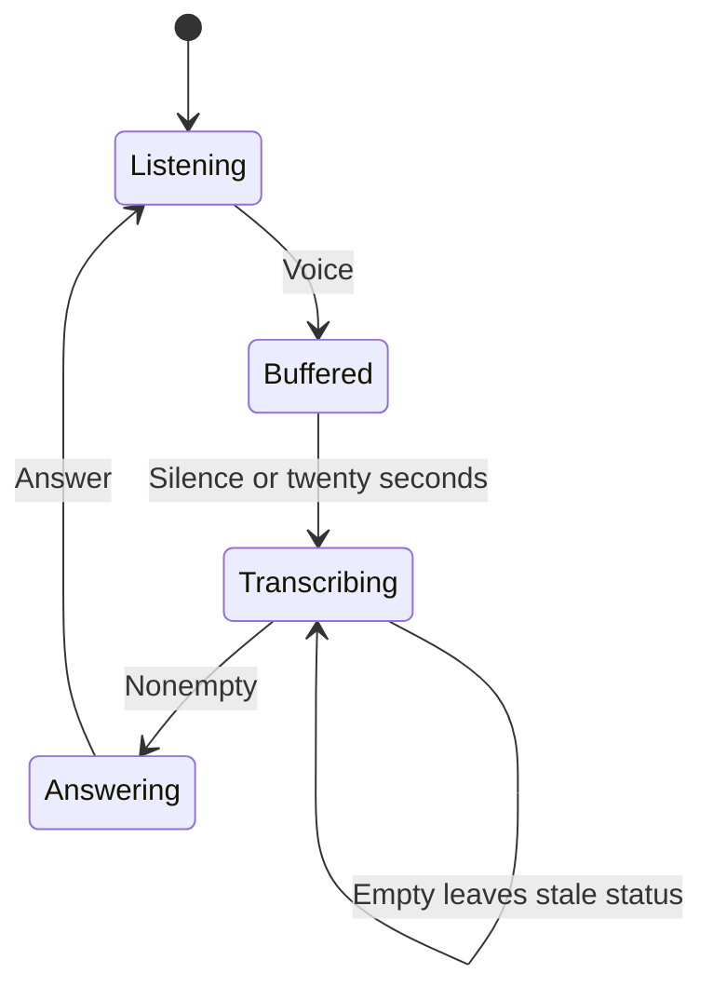
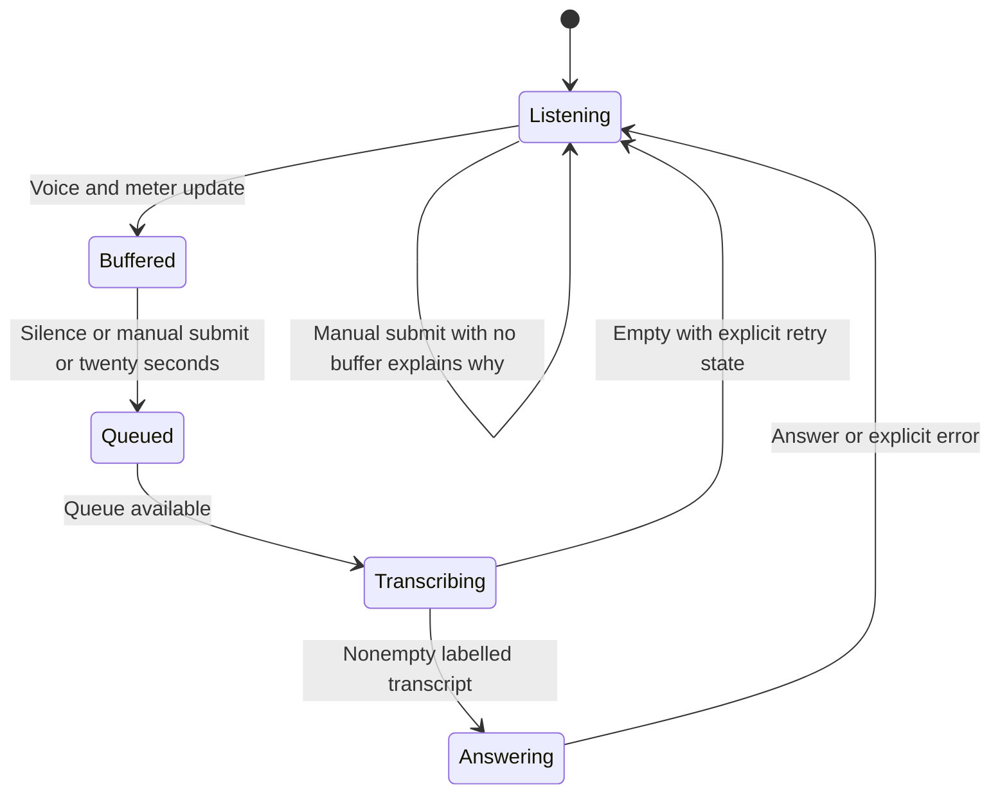
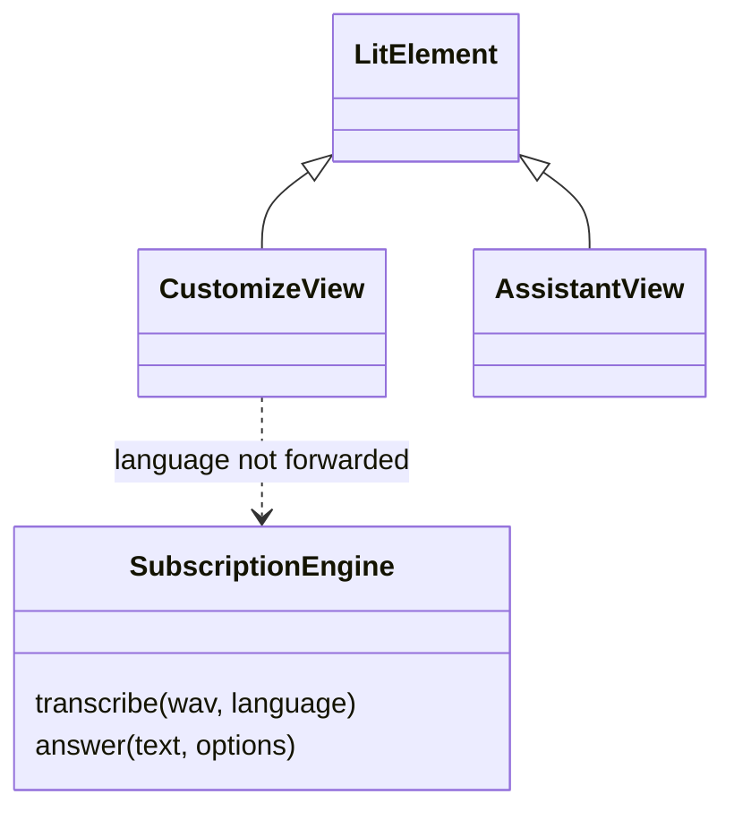
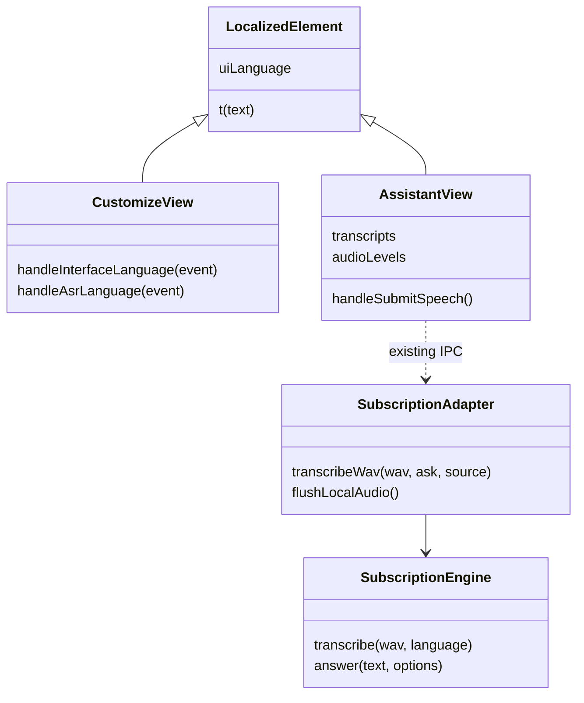

# 0.8.3 语言与语音反馈修复

Fixed point: `171301eff0e492d1cf39f45d163993fc8e83af37`。

用户合同：中文设置不能回到英文；增加独立的通用界面语言；说明谁在说话、自己的问题显示在哪里；说完没有反应时能够观察输入并手动提交。保留现有本地 Qwen3-ASR 与官方 Codex 订阅调用，不做监控规避。

已复现：磁盘和根视图均为 `cmn-CN`，原设置页 select 显示 `en-US`。Lit 初次绑定 select.value 先于动态 options，改为 option.selected。订阅 Adapter 忽略原语言字段；设置页与首页使用两个不同音源字段。语音事件只含文字，空转写覆盖上次内容。

合同：`uiLanguage` 默认 `zh-CN`，立即更新应用自有文案，不翻译用户内容；`selectedLanguage` 是回答语言，默认 `cmn-CN`，支持跟随题目；`asrLanguage` 是本地 ASR 语言，默认 `auto`，可强制 Chinese/English。后两者和音源在下次会话生效。旧用户显式保存的语言不无条件覆盖。第三方反馈网页、模型名与系统错误不承诺翻译。

Subscription Adapter 继续拥有音频分段；`subscription-transcript` 返回 `{text, source}`，空结果不发事件并显示重试状态。source 是 mic/system/file，不是声纹识人；同一音源内的多人不能区分。麦克风＝我/自测，系统声音＝对方来源；两条来源当前都触发回答，没有自动忽略“我”的语音。会话显示最近20条转写（当前会话内存；已有会话存储也保留来源，旧记录显示来源未知），输入电平和实际设置；`subscription-flush-audio` 提交现有的至少250ms有效语音，防止背景声延迟停顿。正常900ms停顿自动提交不变。电平仅证明采集到音量，不证明识别成功。

## 当前架构（0.8.2）

## 目标架构（0.8.3）

## 当前时序

## 目标时序

## 当前状态

## 目标状态

## 当前类关系

## 目标类关系

验证：设置 E2E 使用真实持久化与应用重启；Adapter 回归使用假的外部 ASR/GPT 来精确验证参数和事件，不替代真实模型测试。安装版另测实际中英 ASR、中文订阅回答、截图解题及物理麦克风。回滚仍为最初上游52文件，不是0.8.2；在独立副本执行，之后重新应用累积补丁并对比全部文件。
