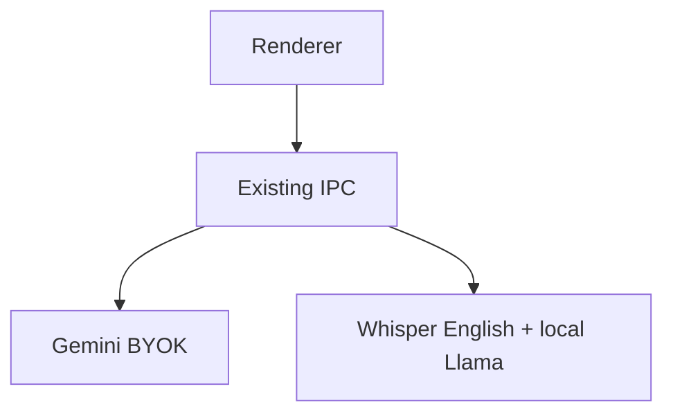
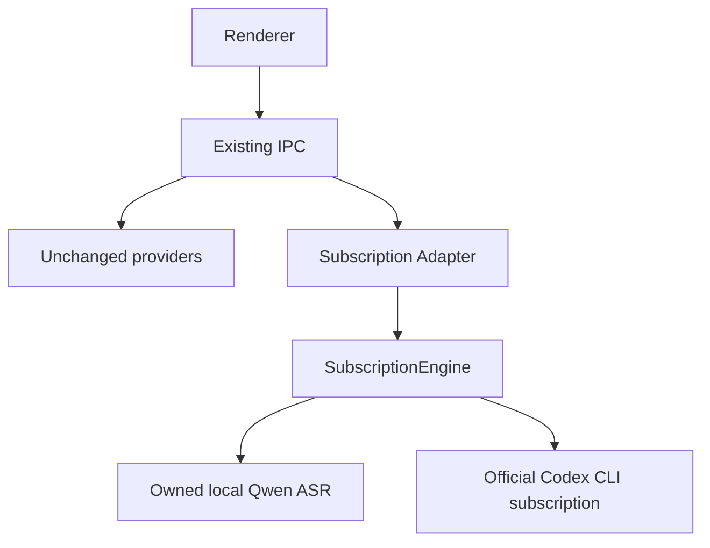
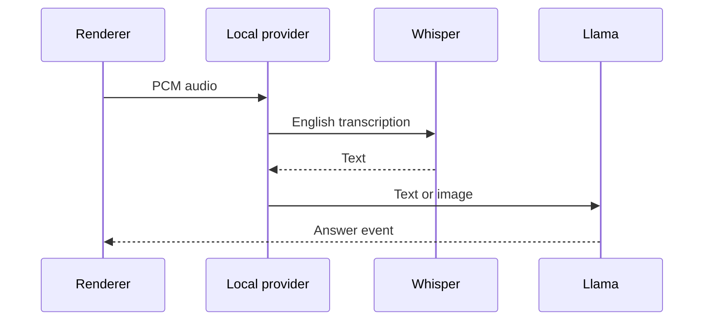
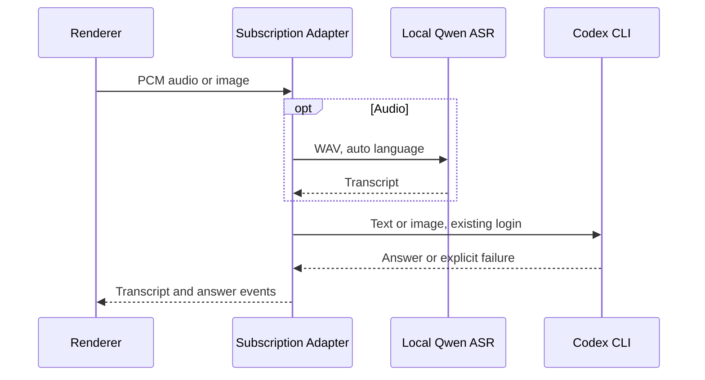
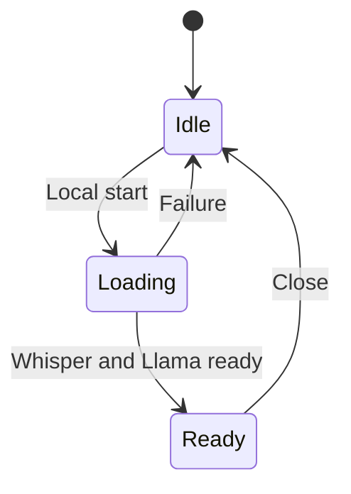
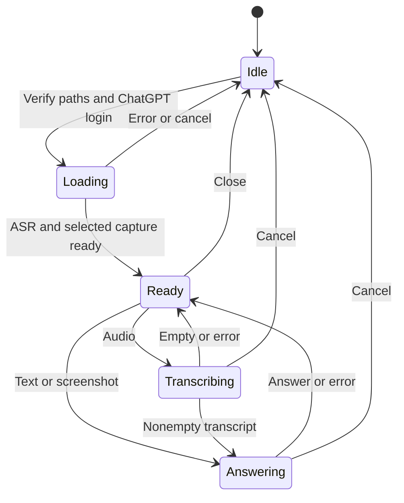
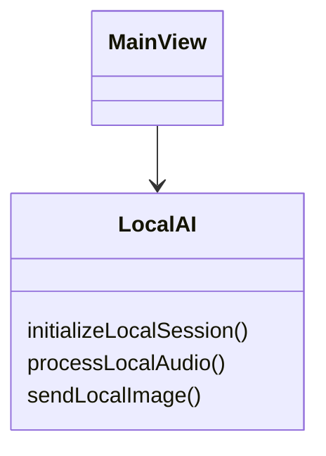
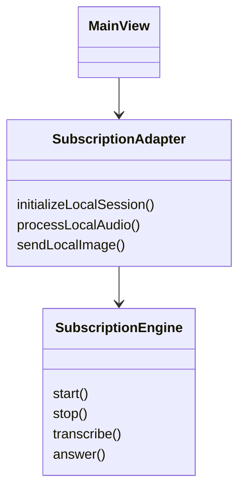

# 本地中英文 ASR + ChatGPT 订阅

Scope: existing fork, branch `custom/local-speech-codex`. Keep BYOK and full-local providers. Add a `subscription` provider: copied VOXT Qwen3-ASR weights + its installed native runtime, official ChatGPT-authenticated Codex CLI for text and screenshots. No credential extraction, monitor-evasion changes, new hosted service, or API billing fallback.

Acceptance: same installed app transcribes neutral Chinese and English WAVs locally, answers both through the subscription, and answers a screenshot. Microphone/system-audio capture needs macOS permission; file-based tests do not substitute for a live capture test. Failures must be shown, not replaced by canned answers.

Module / Interface: `SubscriptionEngine.start/stop/transcribe/answer` owns native process lifecycle and Codex invocation. `subscription.js` is the existing local-provider Interface Adapter, forwarding results through existing renderer events. Files and provider settings are explicit; credentials remain owned by Codex. One request at a time; cancellation terminates owned processes. Image content is untrusted; Codex is read-only with shell/apps disabled.

## Current architecture

## Target architecture

## Current sequence

## Target sequence

## Current states

## Target states

## Current classes

## Target classes

Runtime dependencies: `/Applications/Voxt.app` remains installed, model directory selected in UI, Codex CLI signed in using ChatGPT. No automatic download or paid fallback. Models and scratch files under `work/` stay outside Git.

## 实时麦克风启动修复

订阅模式不在 Start Session 时申请屏幕共享；麦克风启动成功后才进入会话，拒绝权限会显示原始错误并结束模型会话。截图只在 Analyze Screen 时请求。文件模式明确显示未开启麦克风。讲话结束后需停顿约一秒，才提交本地 ASR；播放音频应选择系统声音，不能用文件模式期待自动收音。
