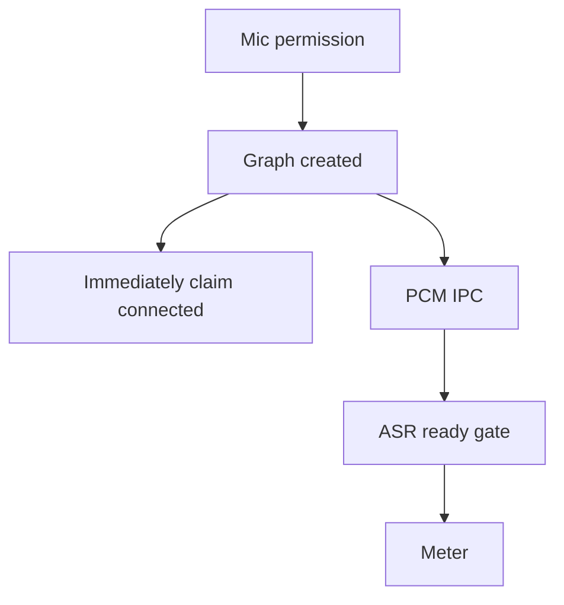
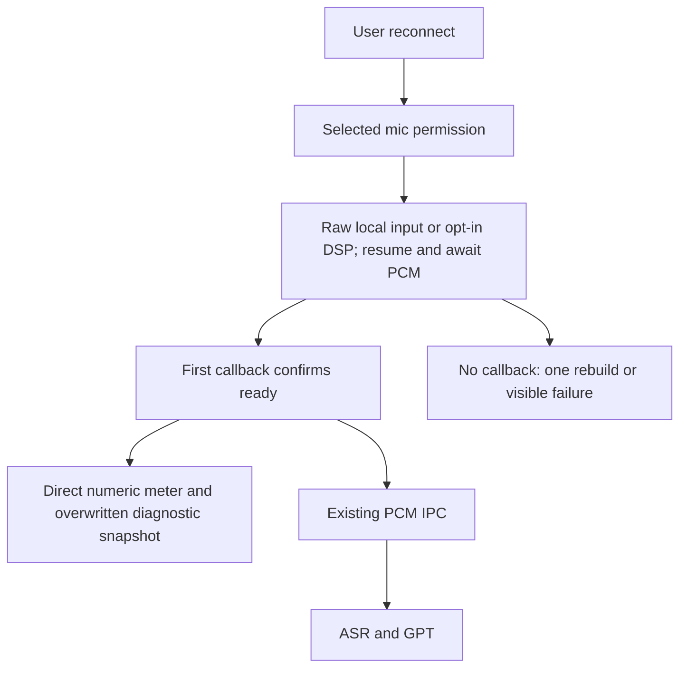
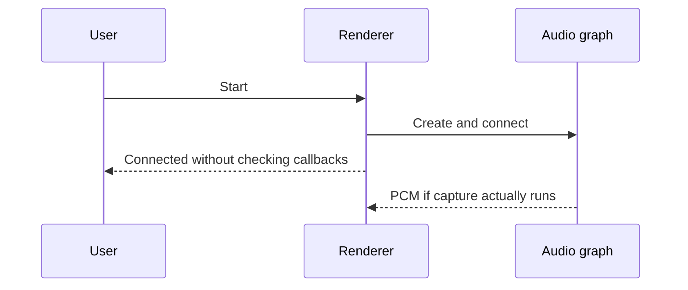
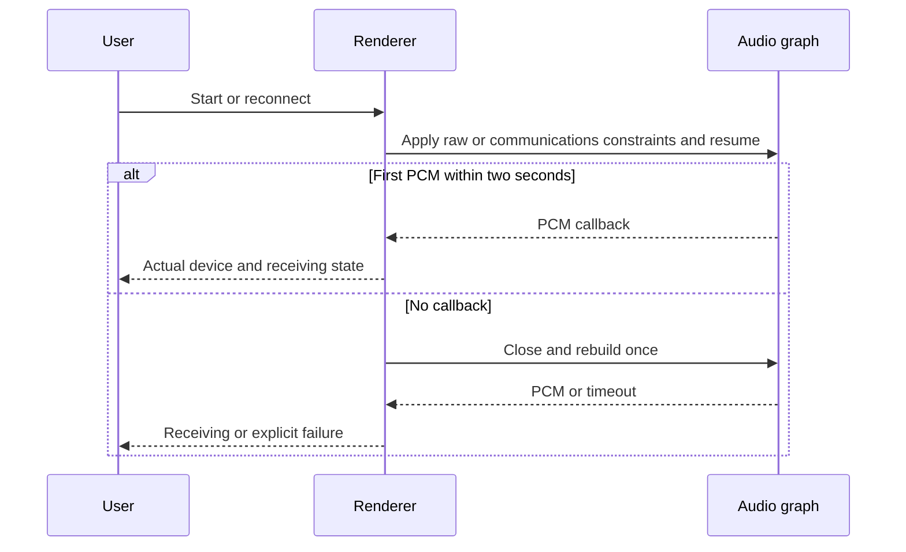
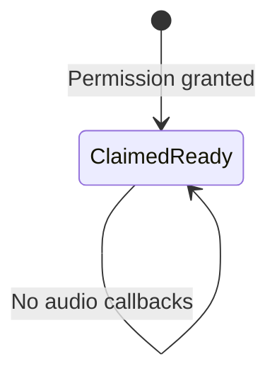
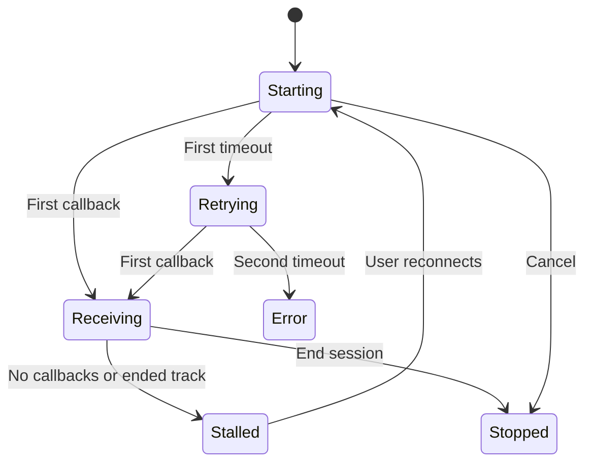
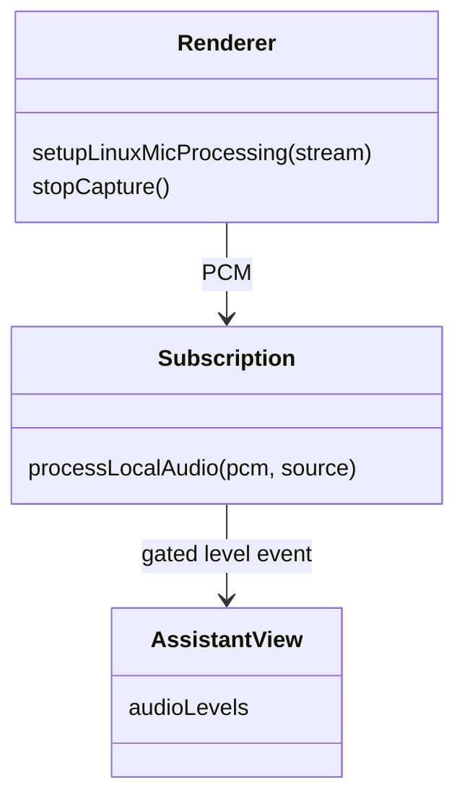
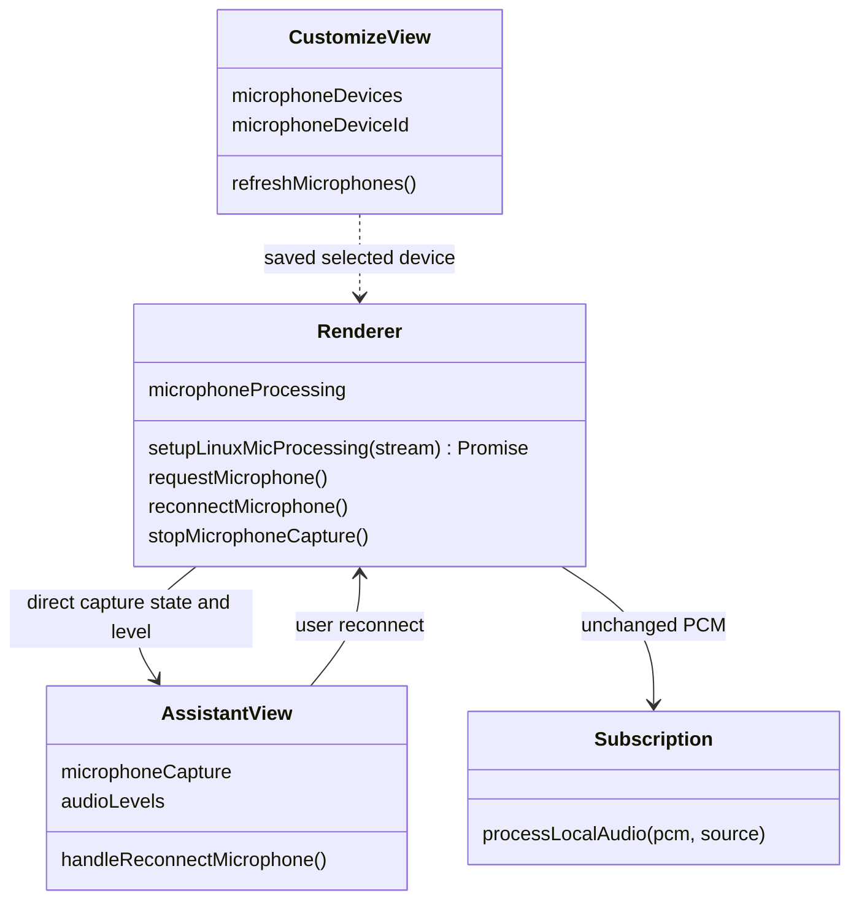

# 0.8.4：麦克风采集不是“拿到权限就成功”

Fixed point: `5c573d05e0c42732d06777292e8d4368d9d00da6`。用户确认“说话时输入电平不动”。TARGET 始终为 cheating-daddy fork；VOXT 仅只读参考，不修改 VOXT、不重置系统隐私权限。

## 观察、推断与未知

- 当前已安装0.8.3，正常 UI 启动显示“麦克风已连接”，播放中性测试音后电平仍为0且没有转写，复现了用户现象；重启新进程后，不新建第二条麦克风流、不新建第二个 AudioContext 的 probe 又收到49次音频回调，并识别到问题。所以不能声称已经确定是权限、默认设备、AudioContext suspended 或某个 macOS 驱动故障。
- 0.8.3 的 setupLinuxMicProcessing 同步返回，未显式 resume、未检查首帧；电平在 Subscription Adapter 内计算且受 engine.ready 限制。启动回归测试实际输出：无回调却已经 ready（RED）。
- 只读参考本地 `/Users/liuqingyuan/work/voxt` commit `fa25ff2`，不是对已安装 VOXT 二进制的运行结论：`Voxt/Transcription/MLXTranscriber.swift:2314` 在1.2秒后检查回调数，0回调则只重建一次；`Voxt/Meeting/Capture/MeetingMicrophoneCapture.swift:33` 选择输入设备、校验格式、安装原生 tap、计算电平，并记录第一次回调。该本地源码与已安装版本是否逐行一致未知。

## 修复合同

保持现有 WebAudio→24k PCM→本地 Qwen ASR→Codex，不盲目迁移整个 Swift 录音模块，不更改监控隐藏机制。setupLinuxMicProcessing 改为 async：显式 resume，等待第一个真实音频回调后才能成功；两秒无回调关闭并重建图一次，仍失败则显示错误。保留 source 强引用，停止清理 source/context/processor/track/watchdog。采集电平在 renderer 的实际 PCM 回调处计算，不依赖 ASR/GPT。持续无回调或 track ended 显示中断；用户可重连麦克风而不重载模型。

新增 `microphoneDeviceId`（空字符串＝系统默认），可在通用设置列出并选定实际设备；不可用的已保存设备不静默替换成别的。会话显示实际设备名和采集状态。设备列表本身只 enumerate，不为了列表额外打开麦克风。重连也遵守已有 macOS 麦克风权限，不代用户放行。

## 当前 / 目标架构

## 当前 / 目标时序

## 当前 / 目标状态

## 当前 / 目标局部类关系

验收以用户真人讲话的电平和转写反馈为准；测试音频、模拟0回调故障、重复启动和静态源码仅是各自范围的证据，不代替用户现场确认。未确认前不标记日常使用已修复。

## 0.8.5：真人反馈失败后的单变量对照

0.8.4 不能验收：用户明确反馈讲话电平仍不动，同一台电脑内置麦克风在 VOXT 可以识别。系统只发现内置输入，CoreAudio input volume=0.9763028，mute=0。最新合同是持续自动录音、自动转写，不要快捷键或按次录音；本批没有新增任何录音快捷键或开始/结束单次录音按钮。

当前可证伪假设：浏览器 communications DSP 与本地 ASR 原始音频路径的差异。0.8.4 强制 echoCancellation/noiseSuppression/autoGainControl 全为 true；参考 VOXT 原生 tap 没有这组浏览器处理。0.8.5 订阅模式默认 raw（三项 false），保留 communications 用于同设备 A/B；其他 provider 原样保留。此改变仍是待真人对照的假设，不将配置差异冒充已证实根因。自动 VAD/本地 ASR/GPT流程不变。

采集回调新增 RMS、峰值、frames/samples数值，避免原生 meter 舍入造成误判。每秒把限定的纯数值/状态覆盖写入既有配置目录 microphone-capture.json，仅接受主窗口 renderer，不接收音频、问题、凭据或用户指定路径；不新增录音流。自动录音状态在会话窗口内可见，无右上角悬浮框。停止时更新 stopped。该诊断文件用于现场检查，不替代真实转写。

## 0.8.6：以用户确认与真实启动路径为准

用户进一步确认：测试进程里本人说话能转写，但正常打开应用一直0；并反馈“截图解题”一直转圈。0.8.5 raw 默认未通过，因此恢复已知 communications 默认，raw只供显式对照。所有录音仍为持续自动，不加快捷键/按次录音。

发现真实打包异常：codesign --verify --deep --strict 报 invalid Info.plist，主签名 Identifier=com.github.Electron，但 Info.plist CFBundleIdentifier=com.liuqingyuan.cheating-daddy-local-gpt。它是明确签名错误，但与零音频的因果关系仍须正常启动实测。新增打包完成后的本地 ad-hoc 签名及严格校验，保留既有 entitlements，不修改 Gatekeeper、TCC、隔离标记或安全 fuses；不宣称 Developer ID 或 Apple 公证。应用自身显式读取麦克风/屏幕权限，麦克风仅在 not-determined 时用系统标准请求；denied/restricted显示用户操作提示，不替用户改权限。

截图修复：handleScreenAnswer真正await捕获和回答，finally清除isAnalyzing。captureManualScreenshot返回真实结果，权限/图像/后端错误可见；屏幕选择30秒、视频启动/就绪5秒超时；迟到屏幕流停止。屏幕源枚举失败或为空时也完成callback拒绝，不能悬挂getDisplayMedia。仅在audioRequested时请求loopback。

验收：必须正常启动安装版，不只terminal/CDP实例；必须点击真实截图按钮看真实桌面题目，不再用导入图片替代。权限对话框交用户处理；若未获权限，记录错误/停止转圈的实测结果并保留题目识别验收待办。
