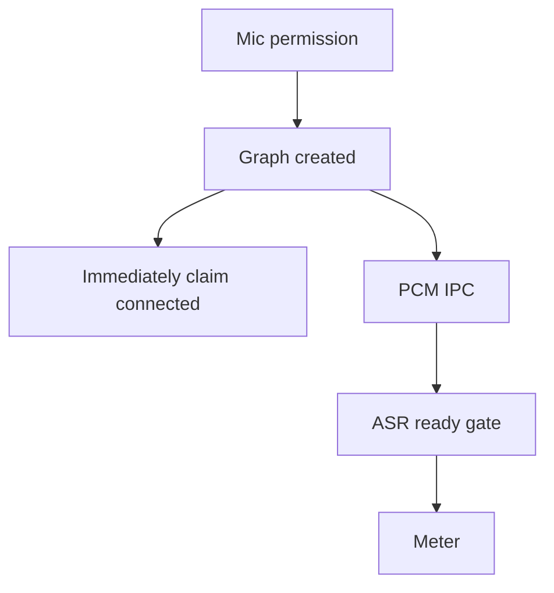
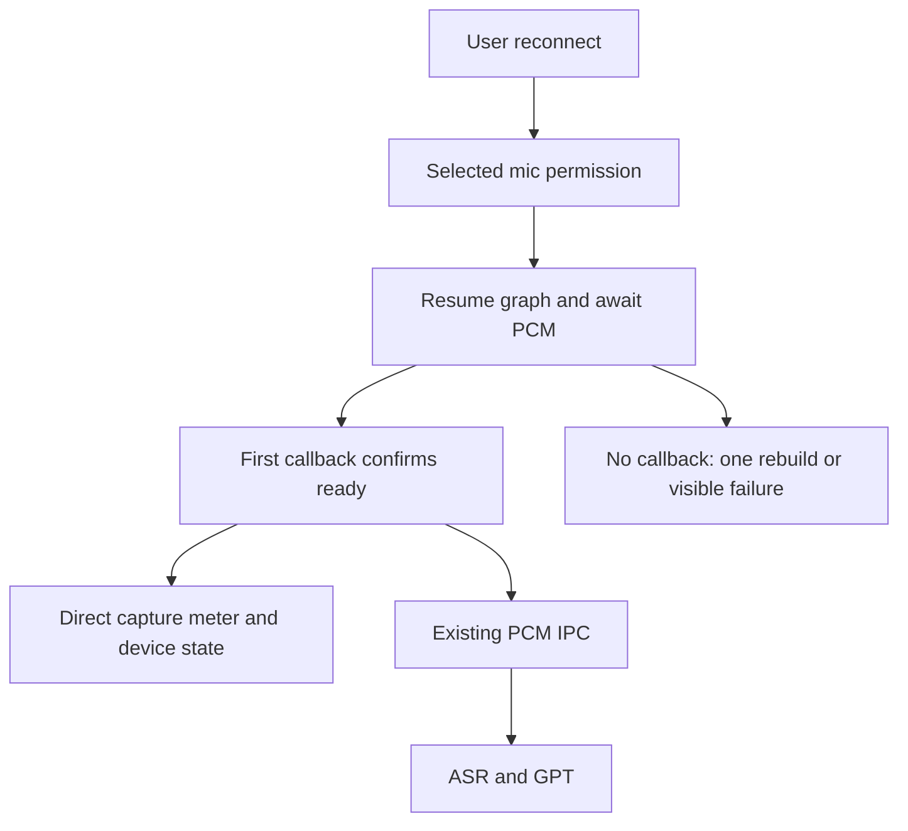
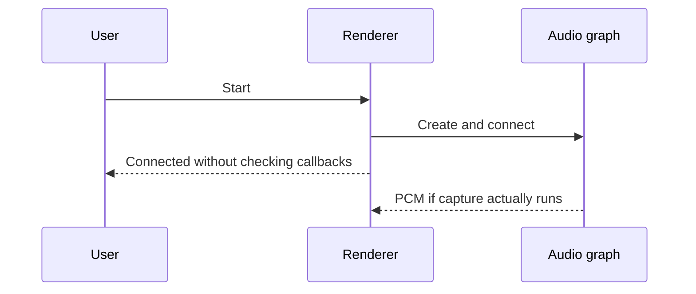
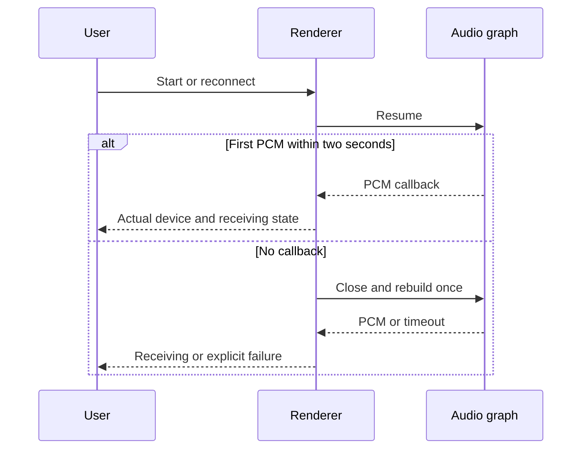
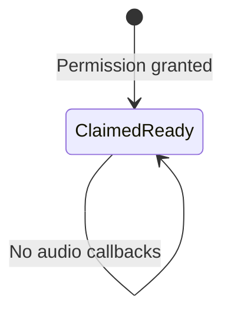
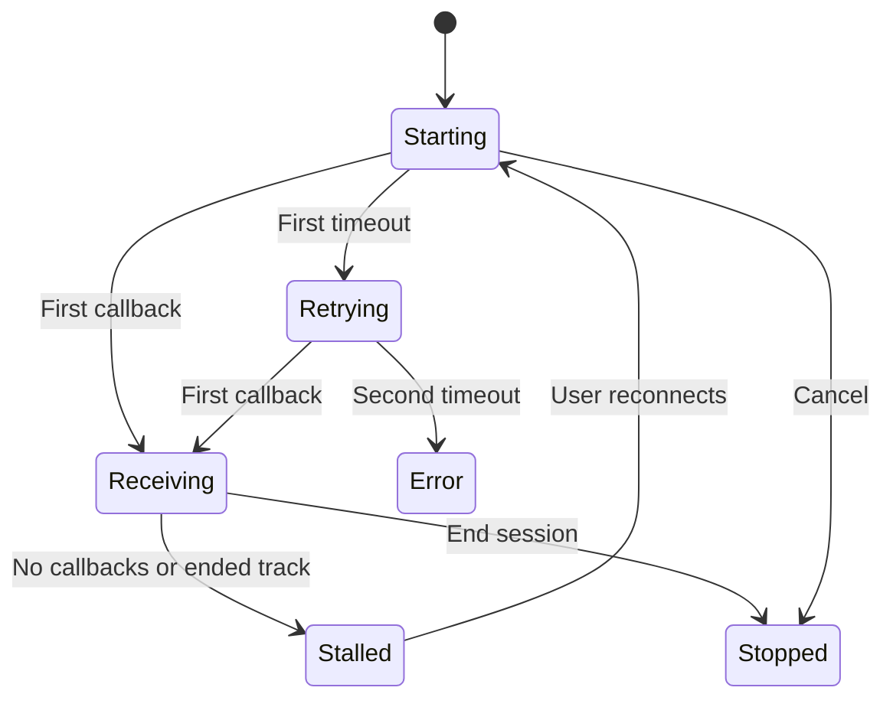
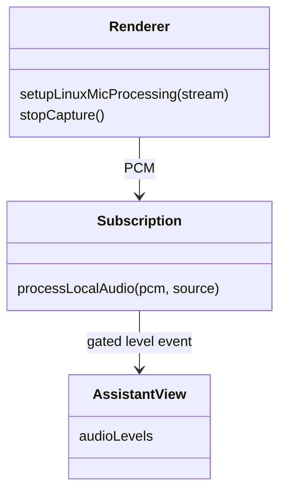
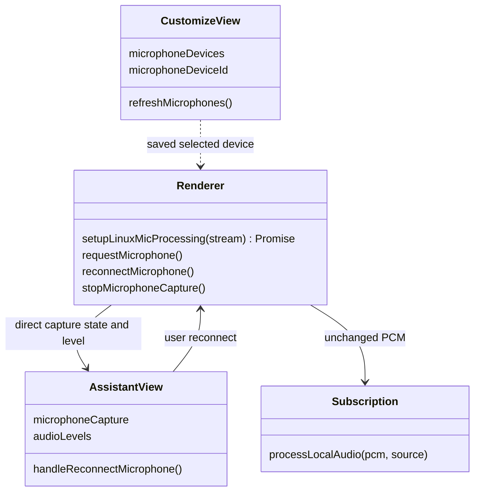

# 0.8.4：麦克风采集不是“拿到权限就成功”

Fixed point: `5c573d05e0c42732d06777292e8d4368d9d00da6`。用户确认“说话时输入电平不动”。TARGET 始终为 cheating-daddy fork；VOXT 仅只读参考，不修改 VOXT、不重置系统隐私权限。

## 观察、推断与未知

- 当前已安装0.8.3，正常 UI 启动显示“麦克风已连接”，播放中性测试音后电平仍为0且没有转写，复现了用户现象；重启新进程后，不新建第二条麦克风流、不新建第二个 AudioContext 的 probe 又收到49次音频回调，并识别到问题。所以不能声称已经确定是权限、默认设备、AudioContext suspended 或某个 macOS 驱动故障。
- 0.8.3 的 setupLinuxMicProcessing 同步返回，未显式 resume、未检查首帧；电平在 Subscription Adapter 内计算且受 engine.ready 限制。启动回归测试实际输出：无回调却已经 ready（RED）。
- 只读参考本地 `/Users/liuqingyuan/work/voxt` commit `fa25ff2`，不是对已安装 VOXT 二进制的运行结论：`Voxt/Transcription/MLXTranscriber.swift:2314` 在1.2秒后检查回调数，0回调则只重建一次；`Voxt/Meeting/Capture/MeetingMicrophoneCapture.swift:33` 选择输入设备、校验格式、安装原生 tap、计算电平，并记录第一次回调。该本地源码与已安装版本是否逐行一致未知。

## 修复合同

保持现有 WebAudio→24k PCM→本地 Qwen ASR→Codex，不盲目迁移整个 Swift 录音模块，不更改监控隐藏机制。setupLinuxMicProcessing 改为 async：显式 resume，等待第一个真实音频回调后才能成功；两秒无回调关闭并重建图一次，仍失败则显示错误。保留 source 强引用，停止清理 source/context/processor/track/watchdog。采集电平在 renderer 的实际 PCM 回调处计算，不依赖 ASR/GPT。持续无回调或 track ended 显示中断；用户可重连麦克风而不重载模型。

新增 `microphoneDeviceId`（空字符串＝系统默认），可在通用设置列出并选定实际设备；不可用的已保存设备不静默替换成别的。会话显示实际设备名和采集状态。设备列表本身只 enumerate，不为了列表额外打开麦克风。重连也遵守已有 macOS 麦克风权限，不代用户放行。

## 当前 / 目标架构

## 当前 / 目标时序

## 当前 / 目标状态

## 当前 / 目标局部类关系

验收以用户真人讲话的电平和转写反馈为准；测试音频、模拟0回调故障、重复启动和静态源码仅是各自范围的证据，不代替用户现场确认。未确认前不标记日常使用已修复。
